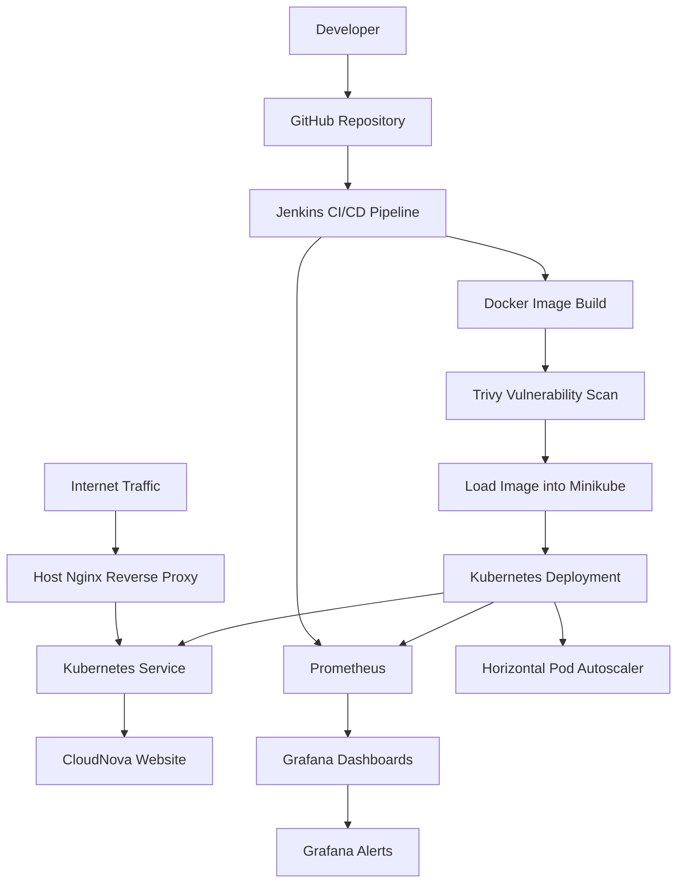

# 🚀 CloudNova – Cloud-Native DevSecOps Platform

A cloud-native DevSecOps project that automates application build, security scanning, deployment, autoscaling, and monitoring using Jenkins, Docker, Kubernetes, Trivy, Prometheus, and Grafana.

## 📌 Project Overview

CloudNova demonstrates how DevOps and security practices can be integrated into a continuous integration and continuous deployment (CI/CD) workflow.

The platform automatically retrieves application source code from GitHub, builds a Docker image, scans it for vulnerabilities using Trivy, and deploys the image to Kubernetes through Jenkins.

Prometheus and Grafana provide monitoring and visualization of application and infrastructure metrics, while Kubernetes Horizontal Pod Autoscaler (HPA) adjusts the number of application replicas based on CPU utilization.

## 🎯 Project Objectives

- Automate application build and deployment.
- Integrate container vulnerability scanning into CI/CD.
- Deploy containerized applications using Kubernetes.
- Implement automatic scaling based on CPU utilization.
- Monitor application and cluster performance.
- Configure alerts for important application conditions.

## 🏗️ Architecture



**Traffic flow:**

Internet → AWS EC2 Nginx → Kubernetes NodePort → Kubernetes Service → CloudNova Website Pods.

## 🛠️ Technologies Used

| Category | Technologies |
|---|---|
| Cloud | AWS EC2 |
| Operating System | Ubuntu Linux |
| Source Control | Git, GitHub |
| CI/CD | Jenkins |
| Containerization | Docker |
| Security Scanning | Trivy |
| Orchestration | Kubernetes, Minikube |
| Package Management | Helm |
| Monitoring | Prometheus |
| Visualization | Grafana |
| Autoscaling | Kubernetes HPA |
| Web Server | Nginx |
| Application | HTML, CSS, JavaScript |

## ⚙️ CI/CD Pipeline

The Jenkins pipeline automates the following stages:

1. **Checkout:** Retrieves the latest source code from GitHub.
2. **Docker Build:** Builds a Docker image with a unique Jenkins build number.
3. **Trivy Security Scan:** Scans the image for HIGH and CRITICAL vulnerabilities and fails the pipeline if they are detected.
4. **Load Image:** Loads the successfully scanned image into Minikube.
5. **Kubernetes Deployment:** Updates the existing Kubernetes deployment with the new image.
6. **Deployment Verification:** Checks the rollout status and verifies running pods.

## 🔐 Security Implementation

- Integrated Trivy container image vulnerability scanning.
- Configured a security gate for HIGH and CRITICAL vulnerabilities.
- Updated vulnerable Alpine packages in the Docker image.
- Configured a dedicated Kubernetes service account for Jenkins deployment.
- Applied namespace-scoped Kubernetes RBAC permissions.
- Used SSH tunnels to access Jenkins, Prometheus, and Grafana rather than exposing their administrative ports publicly.

## ☸️ Kubernetes Implementation

The application runs as a Kubernetes Deployment with:

- Minimum replicas: 3
- Maximum replicas: 5
- CPU autoscaling target: 70%
- Readiness and liveness HTTP probes
- CPU request: 100m
- CPU limit: 500m
- Memory request: 64Mi
- Memory limit: 128Mi

The Horizontal Pod Autoscaler increases or decreases the number of application replicas based on CPU utilization.

## 📊 Monitoring and Alerting

Prometheus collects metrics from Kubernetes and Jenkins.

Grafana provides dashboards for:

- Kubernetes pod CPU usage.
- Kubernetes pod memory usage.
- Running website pods.
- Available deployment replicas.
- Horizontal Pod Autoscaler replica counts.
- Jenkins performance metrics.

**Grafana alerts configured:**

- CloudNova-Website-Replicas-Low
- CloudNova-Website-High-CPU

These alerts help identify resource pressure and reduced application availability.

## 🧪 Testing and Validation

The project was validated through:

- Successful Jenkins CI/CD pipeline execution.
- Docker image vulnerability scanning.
- Kubernetes deployment rollout verification.
- Application HTTP health checks.
- Controlled CPU load testing.
- HPA scaling from 3 to 5 replicas.
- Prometheus metrics verification.
- Grafana dashboard and alert verification.

## 🚀 Getting Started

### Prerequisites

- AWS EC2 Ubuntu instance.
- Docker.
- Jenkins.
- kubectl.
- Minikube.
- Helm.
- Trivy.
- Prometheus and Grafana.

### Clone the repository

```bash
git clone https://github.com/somnathsingh712/cloud-native-devsecops.git

cd cloud-native-devsecops
```

### Build the Docker image

```bash
docker build -t cloudnova-website:latest .
```

### Scan the Docker image

```bash
trivy --config "" image \
  --scanners vuln \
  --exit-code 1 \
  --severity HIGH,CRITICAL \
  cloudnova-website:latest
```

### Check Kubernetes deployment

```bash
kubectl get deployments
kubectl get pods
kubectl get services
```

### Check autoscaling

```bash
kubectl get hpa
```

### Check monitoring components

```bash
kubectl get pods -n monitoring
```

> Note: The Jenkins pipeline uses a configured Minikube image-loading wrapper and a dedicated Kubernetes deployment configuration. The commands above are useful for basic verification; a fresh environment also requires the project-specific infrastructure and access configuration.

## 📚 Key Learning Outcomes

- Practical implementation of CI/CD pipelines.
- Container security and vulnerability management.
- Kubernetes deployment and orchestration.
- Horizontal Pod Autoscaling.
- Monitoring with Prometheus and Grafana.
- Jenkins integration with Kubernetes.
- Linux administration and AWS EC2 management.
- Troubleshooting real-world DevOps deployment issues.

## 🔮 Future Enhancements

- HTTPS using SSL/TLS certificates.
- Infrastructure provisioning using Terraform.
- Centralized logging using Loki.
- Automated deployment through GitHub webhooks.
- Integration of additional security testing tools.
- Migration from Minikube to Amazon EKS.

## 👨‍💻 Author

**Somnath Singh Yadav**

B.Tech – Information Technology

GitHub: [somnathsingh712](https://github.com/somnathsingh712)

Project Repository: [CloudNova – Cloud-Native DevSecOps](https://github.com/somnathsingh712/cloud-native-devsecops)

---

⭐ If you find this project interesting, feel free to explore the repository.
